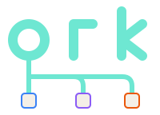

# ork

A terminal dashboard and engine for parallel slice relays across projects.

## Status

In development: the core registry and CLI adapters (S02), the role
prompts (S10), the TUI shell with project tabs and the Overview (S11), and the
daemon's wiring into the binary (S13) are in. `go run ./cmd/ork` opens the
dashboard over the projects in your registry, through a background daemon that
starts when none runs. It can approve, stop and retry a run from the
Overview, and answer a paused run's question in its detail pane. `ork status` and `ork projects` use
the same daemon, and `ork roles print` and `ork doctor` run in the command
itself; `ork --version` prints the version. v1 is the monitoring
dashboard plus launching and supervising slice waves. See [PROJECT.md](PROJECT.md).

`ork wave suggest PROJECT` prints slicer's suggested waves. Choose item ids
and run `ork wave start PROJECT ITEM...` to review the plans and confirm
the launch. `ork stop WAVE` stops the unfinished runs in the returned
`wave-` id, including queued runs.
The Waves screen also composes and launches waves.

## Install

*Proposed:* download the archive for darwin/arm64, darwin/amd64 or linux/amd64
from the [GitHub release](https://github.com/squalor-xyz/ork/releases).
Verify it against the release's `SHA256SUMS`, extract it, and put `ork` in a
directory on your `PATH`. Archives include `LICENSE`, `NOTICE` and this README.
The release workflow publishes binaries when the owner pushes a `v*` tag.

From the repository root, with Go installed:

    go install ./cmd/ork

Go writes `ork` to `$(go env GOBIN)`, or to `$(go env GOPATH)/bin` when
`GOBIN` is unset. `GOPATH` defaults to `~/go`, so no sudo is needed unless you
set `GOBIN` or `GOPATH` elsewhere. Put that directory on your `PATH`. `ork doctor` prints the path of the binary
it runs, which shows which copy you are calling.
`ork doctor` also prints the commands to upgrade slicer, adj or ork when one is
behind or missing, and `ork doctor --upgrade` prints them for all three. It runs
none of them.

## What ork is

One TUI over all your projects (slicer, adjudicate, DataBall, agents):

- See each project's roadmap and decisions, and every slice that is
  running, with each role's stage, live output, tokens, cost and tests.
- Pick a wave of slices (slicer suggests it), approve it, and ork runs
  every slice: worktree, implementer, deterministic checks, review, fix
  rounds and gate, on Claude, Codex or Grok, with vendor fallback.
- Approve a passed slice and ork commits its branch. You land it.

A background daemon keeps waves running when the TUI is closed. ork reads
and writes slicer and adj only through their CLIs.

## Guide

- [docs/guide.md](docs/guide.md): a walk-through for a new owner, from
  install to a landed slice, a wave, and daily monitoring.
- [docs/diagrams.md](docs/diagrams.md): Mermaid diagrams of the components,
  a run's states, one relay round, a wave, setup and daily use.
- [docs/orchestrator-parity.md](docs/orchestrator-parity.md): what the
  outer orchestrating session does that ork does, partly does, or does not.

## Documents

- [PROJECT.md](PROJECT.md): summary, v1 scope, goals, non-goals, risks.
- [docs/design.md](docs/design.md): the engine: wave lifecycle, slice state
  machine, roles, vendors, CLI, build order.
- [docs/dashboard.md](docs/dashboard.md): the screens.
- [docs/state.md](docs/state.md): the files ork owns.
- [docs/boundaries.md](docs/boundaries.md): what slicer, adjudicate, the
  agents repo and ork each own.
- [docs/glossary.md](docs/glossary.md): terms.
- [docs/manual-steps.md](docs/manual-steps.md): the manual relay steps ork
  replaces.
- [docs/review-2026-10-18.md](docs/review-2026-10-18.md): the spec review
  and how each finding was resolved.
- [AGENTS.md](AGENTS.md): rules for agents working in this repo.

Owner decisions are adj records: `adj list --status decided`. The open
questions are in `adj inbox`. The roadmap is in slicer: `slicer list`.

## License

GPL-3.0-or-later. See [LICENSE](LICENSE) and [NOTICE](NOTICE). Copyright
Squalor LLC.
