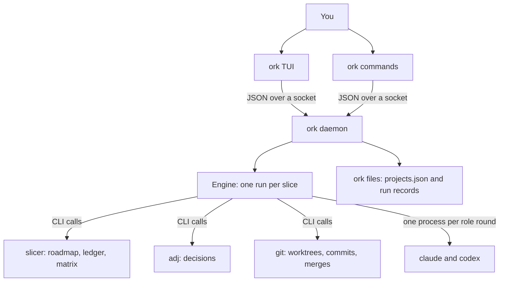
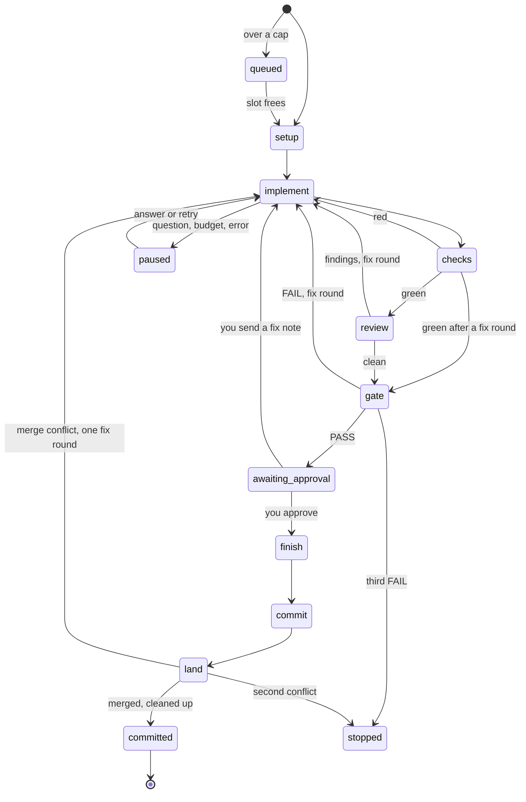
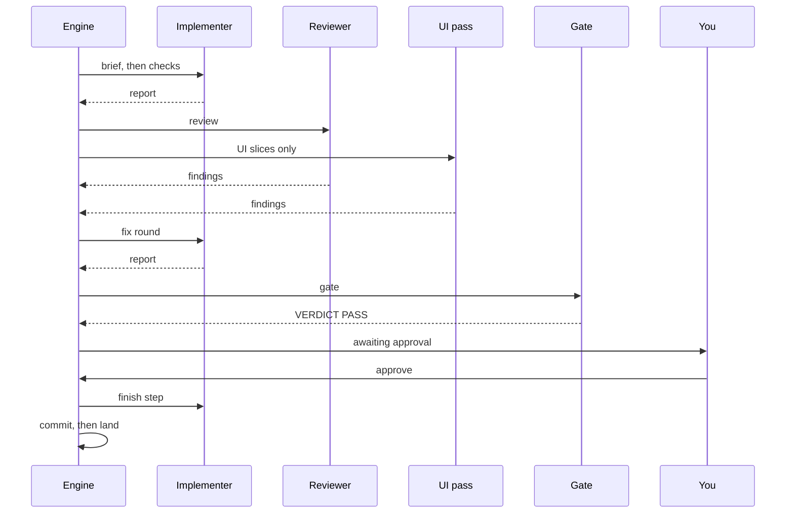
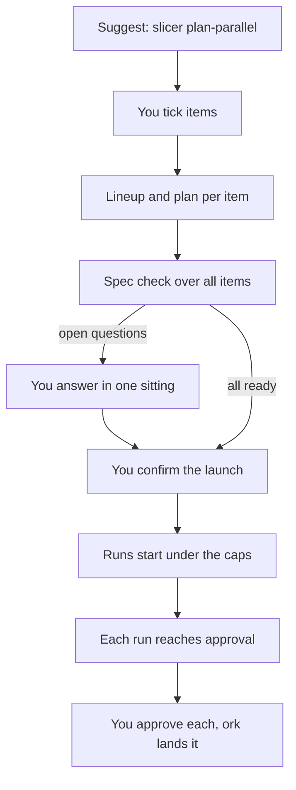
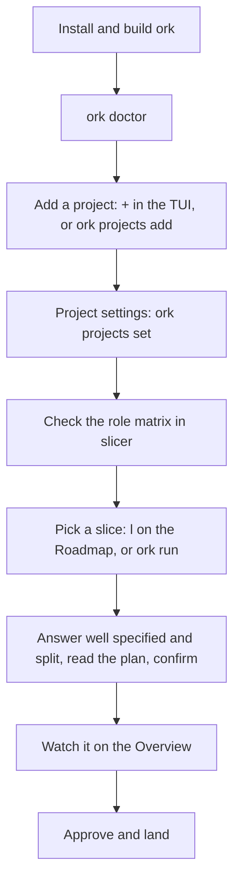
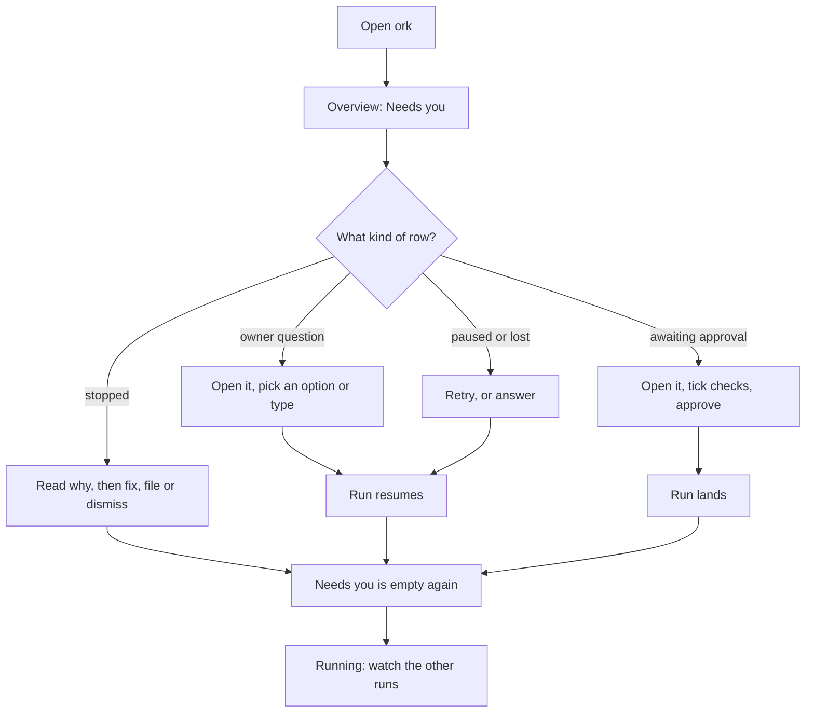

# Diagrams

Six pictures of how ork works. Each one shows one idea. They are Mermaid
text, so a Markdown viewer that supports Mermaid draws them. The walk-through
that goes with them is [guide.md](guide.md). The engine details are in
[design.md](design.md) and the files in [state.md](state.md).

Every command and key named here was checked against the code (see
[guide.md](guide.md)). The design documents still call some of them
*proposed*; the code has them. A step that does not exist yet is marked
*proposed* in the text under its diagram.

## 1. Components and data flow

Who talks to whom. The daemon is the only writer. The TUI and the CLI are
clients that call it over a Unix socket (`docs/design.md:10-20`). ork reaches
slicer, adj and git only through their command lines
(`docs/boundaries.md`).

What to take from it:

- Close the TUI and the daemon keeps the runs going.
- Roles (implementer, reviewer and so on) are plain vendor processes. They
  do not spawn agents.
- ork keeps its own files only in `~/.config/ork` and `~/.local/state/ork`.
  Everything else is read live from slicer, adj and git.

## 2. A run's states

One slice run, from launch to landed. Any state can go to `paused` (a
question, a budget limit or an error) or to `stopped` (a stop rule or your
stop). The names are the states in `internal/runrec/record.go:22-35`.

Notes:

- `awaiting_approval` is the state `awaiting-approval` (Mermaid does not
  allow the hyphen).
- When the lineup has an architect (the matrix gives one on size L), an `architect` round runs after review and before the
  gate (`docs/design.md:233`). It is left out here to keep the picture short.
- A stopped run waits in Needs you until you dismiss it (`ork dismiss RUN`).

## 3. One relay round

The roles of one slice, in order, with what you do. The reviewer and the UI
pass run at the same time. The UI pass runs only on a slice that touches the
UI (`docs/design.md:269-275`).

Notes:

- A gate FAIL sends the engine back to the implementer for a fix round. A
  third FAIL stops the run.
- If a role needs you (an `Owner needed` section), the run pauses and
  waits for your answer. See diagram 6.
- Landing is: merge the base branch into the worktree if it moved, re-check,
  fast-forward the main checkout, `slicer land`, push if the project's `push`
  is on, then remove the worktree and branch (`docs/design.md:351-382`).

## 4. A wave

A wave is a set of slices from one project that start together. Slicer
suggests it. You pick the items, ork plans them and checks the specs, and you
confirm once.

Notes:

- One wave holds one project. Several waves can run at once
  (`docs/design.md:212-214`).
- The global cap is 4 busy runs unless the registry sets `global_cap`
  (`internal/daemon/runs.go:44`). A project has no cap unless its `cap` is set
  (`internal/daemon/runs.go:727-745`). An item over a cap waits as `queued`.
- One failed or stopped item leaves the others running. `ork stop WAVE`
  stops every unfinished member.

## 5. Setup to first run

From nothing to a first landed slice.

Notes:

- Step "Check the role matrix" is done with `slicer relay-roles` outside ork
  today. ork shows the chosen lineup in the plan and lets you change it for
  one run (`e` in Waves). It does not edit the matrix.
- `ork doctor` reports whether the slicer contract is one ork accepts. It is
  not a gate: the engine makes the same contract check itself before it
  creates a run (`docs/design.md:1117-1121`).

## 6. Daily monitoring and answering

What to do each time you open ork. Needs you is the first screen.

Notes:

- The Questions view lists every owner question from every project in one
  place, so you can answer them without visiting each project.
- The sidebar shows a count and a bell sounds when something newly needs you.
- `ork status` prints the same Needs you counts on the command line.
