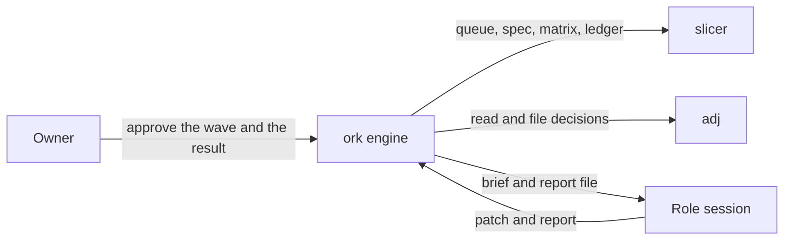
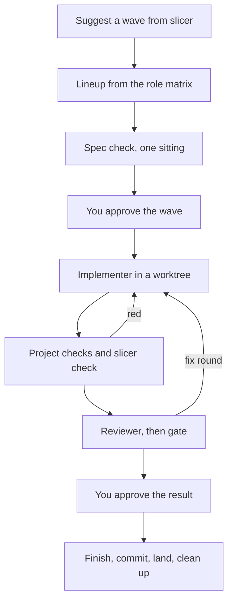

# How ork works

Read this first. It is the short picture of ork, slicer and adj. The
pictures of states, one relay round, a wave, setup and daily use are in
[diagrams.md](diagrams.md). The commands are in [guide.md](guide.md). The
engine spec is in [design.md](design.md).

## The three tools

| Tool | Owns | ork may |
|---|---|---|
| slicer | The queue, slice specs, the role matrix, the relay rules, the ledger | Read and write only through the `slicer` command |
| adj | Decisions. A record is open, decided, or closed | Ask, check, and record an answer the owner picked |
| ork | The dashboard, the run records, the role prompts, the state machine | Launch a role, run the checks, pause for the owner, commit and land after approval |

The table is the short form of [boundaries.md](boundaries.md). ork does not
open `.slicer/` or `decisions/`.

You approve the wave, and you approve the result. Between those two stops
ork is the state machine. It starts each role as its own process (`claude`,
`codex` or `grok`) and reads the report that process writes
(`docs/design.md:18-19`, `docs/boundaries.md:69-70`). There is no outer chat
session holding the queue.

The TUI and the commands are clients of a daemon (`docs/design.md:22-24`).
Close the TUI and a run that is still going keeps going
(`docs/diagrams.md:36`). The component picture, including git and ork's
own files, is diagram 1 in [diagrams.md](diagrams.md).

## One slice

Setup creates the worktree and the branch, and begins the ledger run
(`docs/design.md:285-291`). The implementer writes the slice. ork runs the
project check command and `slicer check` itself. A red result goes back to
the implementer and does not spend a review (`docs/design.md:294-298`).
*Proposed (S279):* when the branch is behind main and `slicer check` is red
only on other items, the round is not red: ork logs those problems, tells the
reviewer and the gate, and leaves them to the landing merge and re-check.

The reviewer did not write the code (`docs/design.md:848-849`). On a slice
whose files touch the UI, a UI pass runs beside the reviewer, not instead
of it (`docs/design.md:304-311`). When the lineup has an architect, that
round runs after review and before the gate (`docs/design.md:300-303`).
The gate uses the reviewer's lineup. A gate override at launch is refused
(`docs/design.md:189-190`).

A passed gate waits for you. After you approve, ork finishes, commits and
lands (`docs/design.md:250-254`).

The state names, the third gate FAIL, and a merge conflict on land are
diagram 2 in [diagrams.md](diagrams.md). The order of one round, including
the UI pass, is diagram 3. A wave is diagram 4.

## Who does which kind of job

The role matrix in slicer names the vendor, the model and the effort for
each role. ork does not edit the matrix. It reads a recommendation per
slice and can change that one run (`docs/design.md:174-183`,
`docs/guide.md:168-186`). To see the current rows:

    ork roles matrix PROJECT
    slicer relay-roles show --root DIR

| Kind of work | Who | What they do |
|---|---|---|
| Draft | Implementer | Writes the slice in the worktree. A split may use a lead and parts. |
| Check | ork | Runs the project checks and `slicer check` before anyone reviews the diff. |
| Judge | Reviewer, then gate | Reads the diff. The reviewer reports findings. The gate says pass or fail, on the reviewer's lineup. |
| Judge | Architect | Reads the slice when the lineup has an architect entry. ork does not decide that from the size label alone (`docs/design.md:300-303`). |
| Judge | UI pass | Reads the screen on a slice that touches the UI, beside the reviewer. |
| Read and ask | Spec check | Reads the specs of the ticked slices before the wave starts, so you can answer in one sitting. |

A model written `FAMILY@latest` (for example `grok-*@latest`) runs the newest
model of that family, which ork resolves from the vendor's model list when it
builds the plan (*proposed*, S244; `docs/design.md`, lineup section). A bare
`latest` is refused.

Grok runs read-only roles today, in `--permission-mode plan`, and ork
refuses a Grok write role (*proposed*, S72, no adj record yet). A plan skips
a Grok implementer row with a reason, and a launch override that names Grok
as the implementer gets `bad_params` (*proposed*, S268). Probes of
`dontAsk` and `acceptEdits` refused a headless edit because the run cannot
ask for approval. Plan mode wrote nothing in the one edit probe. The owner
ruled out `bypassPermissions` and `--always-approve` on 3 November 2026.
Modes that would skip the prompt were not measured, so this is ork's rule
on those probes and that instruction, not a measured limit of every
headless mode. Wave 7 and 8 fixtures show single `git status --short`,
`git diff -- PATH` and `git diff --check -- PATH` commands running, plus
`read_file`, `grep` and `list_dir`. `rg`, `slicer` and tests remain unverified.
Grok read-only briefs name those verified forms and require one command per
call, without compound commands, echo, redirects or `python3 -c`.

*Proposed* (S280): a cancelled stream result plus stderr `permission required`
is an error exit. The next role row takes the same round without marking
Grok out. If a non-empty report file exists, ork keeps it instead. Otherwise
it keeps the last complete assistant text only when it contains the exact
line `## Owner needed`; partial deltas and tool-only messages do not replace
that text. A retained report returns OK for the normal report shape check.
The reason still names the refused command, truncated to 60 characters.
Spec checks build each row's brief with that row's vendor limits.

Fallback runs when a role exits rate-limited or in error, on the next row
of that role's chain. The gate's chain is the reviewer's.

## Where to go next

- [guide.md](guide.md): install, add a project, run one slice, run a wave, answer, approve and land.
- [diagrams.md](diagrams.md): the six pictures. States, one round, a wave, setup, and what to do when you open ork.
- [design.md](design.md): the engine. Wave lifecycle, the state machine, roles, vendors, budgets and the CLI.
- [dashboard.md](dashboard.md): the screens.
- [state.md](state.md): the files ork owns (`projects.json`, run records).
- [boundaries.md](boundaries.md): what slicer, adj, the agents repo and ork each own, including the relay contract.
- [glossary.md](glossary.md): the terms, as this repo uses them.
- [../PROJECT.md](../PROJECT.md): what ork is, why it exists, and what v1 includes.
